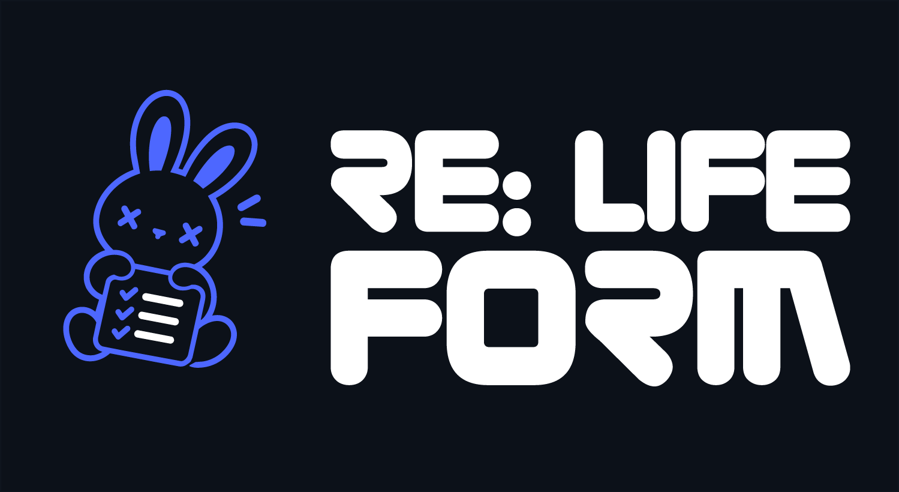

# Дизайн, айдентика и изменения

## Источники и границы

Источники: девять сохранённых пользовательских изображений, шаблоны, CSS/JS и Git. Референсы находятся в `docs/assets/`; они не являются автоматически скриншотами текущего приложения. Здесь фиксируется состояние по исходникам и подтверждённые изменения, без новой визуальной проверки desktop-окна.

Ранний LIFE APP использовал розовый акцент. Синие концепты RE:FORM LIFE развили календарную композицию, фирменный знак и кролика с чек-листом. Позднее интерфейс начал использовать знак EVE. Окончательное утверждение единой бренд-системы в репозитории не найдено.

## Логотип: что было и стало

| Элемент | До | Сейчас/изменение | Доказательство |
| --- | --- | --- | --- |
| Знак в sidebar | `static/img/logo.svg` | `static/img/eve-logo.ico` | `f778f39`, base.html |
| Знак в приветствии | logo.svg | eve-logo.ico | Тот же коммит |
| Favicon | В этой замене добавлен отдельный favicon | eve-logo.ico | Тот же коммит |
| Размер знака | При внедрении 68/104 px | Sidebar 140 × 140; приветствие 220 × 220 | `fdb1bd0`, `7a3425b`, reference.css |
| Знак на странице EVE | Синий эффект общей оболочки | Grayscale, normal blend | `b5a4c9d`, eve-orbit.css |
| Прежний SVG | Использовался в оболочке | Файл сохранён | ASSETS и git ls-files |
| Знак для упаковки | app.ico/app.icns | Отдельные файлы сборок сохранены | spec-файлы; визуальное совпадение не проверено |

Название окна и приложения осталось RE:FORM LIFE. Поэтому текущая оболочка сочетает название продукта с картинкой EVE. Рекомендация различать бренд продукта и имя ассистента из прежнего дизайн-отчёта остаётся рекомендацией, а не подтверждённым бренд-решением.

## Галерея сохранённых вариантов

| Группа | Файлы | Статус |
| --- | --- | --- |
| Розовые недельные | weekly-original.jpg, weekly-original-alt.jpg | Ранние концепты |
| Синий недельный | weekly-blue.png | Развитие концепта |
| Месячные | monthly-blue.png, monthly-jpg.jpg, monthly-compact.png | Несколько вариантов макета |
| Маскот | mascot-dark.jpg, mascot-line.png | Варианты персонажа |
| Бренд | brand-lockup.png | Референс фирменной композиции |

Оригинальные имена вложений — [assets/README](../assets/README.md), точные хеши — [ASSETS](ASSETS.md). Файлы `static/img/maskot.svg`, `bunny.png`, `Group-*.svg` и иконки навигации также сохранены. Сам факт сохранения не означает использования во всех экранах.

## Как применяются стили

Порядок в base.html: style.css → week-legacy.css только для недели → reference.css → eve-orbit.css только для assistant. Более поздние селекторы и !important влияют на конечный вид.

В reference.css есть исходные токены и более поздние переопределения фонов. Поэтому первая таблица :root не описывает целиком отрисованный интерфейс. Для EVE последним подключается локальная палитра, ограниченная `body[data-page="assistant"]`; её нельзя переносить на все экраны.

## Цвета и типографика

| Роль | Базовые токены reference.css | Последний слой EVE |
| --- | --- | --- |
| Фон | #070c13, затем общие фоновые переопределения #12182a | #494d56 |
| Sidebar / panel | #0d121b / #0c111a | #202332 |
| Мягкая поверхность | #111925 | #434e60 |
| Основной текст | #f4f6fa | #f4f1eb |
| Вторичный текст | #9ca6b6 | #8b9a9f |
| Акцент | #4d67ff | #bc9876 |
| Положительное состояние | #35c98a | Существующие состояния требуют отдельной проверки каскада |

EVE-палитра взята из supplied Twinkle JPG согласно комментарию CSS и истории `9d0a6c9`. Сам исходный Twinkle JPG отдельным файлом в отслеживаемых docs/assets не обнаружен; нельзя выдавать сохранённую галерею за его источник.

Rubik Regular подключён @font-face из локального TTF. Duepuntozero Pro сохранён набором OTF; проверка прав и полного применения не проведена. Имя `--pink` историческое: оно содержит синий базовый акцент и бежевый на EVE.

## Эволюция экрана ассистента

| Этап | Изменение | Коммиты |
| --- | --- | --- |
| Единый чат | Общая область разговора и управления задачами | d6eef5f, 9228133 |
| Голосовые состояния | Анимация состояния и обновление ресурсов | 8167f74 |
| Orbit | Реактивный слоистый круговой аватар в существующей компоновке | ed9ee37 |
| Исправления Orbit | Изоляция анимаций, устранение наложения header | de7078b |
| Плоские поверхности | Убраны градиенты аватара и объёмные эффекты выбранных поверхностей | 7721fc8 |
| Настройка элементов | Коррекция плоских контролов и документирование палитры | d1bc656 |
| Twinkle | Серо-синяя палитра, бежевый акцент | 9d0a6c9 |
| Навигация | Нейтрализация синей графики и знака только на EVE | b5a4c9d |
| Equalizer | Круг заменён нижним холмообразным эквалайзером | 6f7849f |
| Небольшие размеры | Коррекция высоты пиков | 1fad4b4 |
| Волна | Плавная градиентная SVG-волна под полем ввода | 32af47e |
| Состояние покоя | Уточнена форма resting-волны и размещение | 067227a |

## Что убрано, что заменено, что осталось

- Круговой Orbit-аватар заменён из текущей композиции assistant. Класс/имя файла eve-orbit.css осталось историческим.
- Отдельная боковая область визуализатора заменена волной внутри `assistant-chat-compose`, после поля и статуса.
- Градиенты и свечение некоторых прежних поверхностей убраны плоским слоем. Финальная SVG-волна снова имеет вертикальный градиент: утверждать «все градиенты удалены» неверно.
- Синий цвет и эффекты графики навигации подавлены фильтром на assistant; исходные картинки и синие стили других страниц сохранены.
- logo.svg заменён в sidebar/приветствии, но не удалён из Git.
- Девять старых референсов, маскоты, шрифты и презентации сохранены.
- Старые CSS-селекторы могут оставаться в reference.css после удаления соответствующей разметки. Наличие селектора не доказывает наличие элемента.

## Финальная волна

Разметка: `templates/assistant.html`, SVG `assistantEqualizer`, path `assistantWavePath`, `linearGradient#eveWaveFill`. Верх градиента #bc9876/.95, низ #8b9a9f/.12. Это кодовая SVG-графика, не картинка логотипа.

Состояния: off, idle, listening, speaking, processing, confirmation. При listening используется измеренный microphoneLevel; speaking/processing меняют форму по времени. Это визуализация состояния и входной громкости; её нельзя описывать как точный спектральный анализ выходного звука.

Отрисовка через requestAnimationFrame с интервалом от 32 ms. В активных состояниях цикл продолжается; при prefers-reduced-motion движение ограничивается. При pagehide кадр отменяется. Высота: 88 px, при max-width 900 — 62, при max-height 650 — 48.

Media query волны не означает готовности всего продукта к телефону: базовая оболочка и минимальный desktop-размер остаются широкими.

## Компоновка и доступность

Недельный экран организован семью днями, заметками и целью; месячный — сеткой, поиском, приоритетами и календарными контролами. EVE содержит чат, каталог, редактор фраз, composer, микрофон, статусы, волну и настройки.

В коде есть aria-label, aria-live, aria-pressed и семантика диалогов. Для релиза нужны отдельные проверки клавиатуры, focus trap/return, контраста и состояния загрузки/ошибки. В старых концептах отмечены несогласованные числа статистики и повторяющиеся даты; это замечания к референсам, а не подтверждённая ошибка актуального вычисления API.

## Презентации

14 октября добавлены общая презентация проекта, ресурсная карта и отдельная ресурсная презентация; затем появились упрощённые версии и уточнение палитры. Форматы PDF/PPTX отмечены бинарными в docs/project-plan/.gitattributes. Это изменение презентационных материалов, а не доказательство смены палитры всех экранов приложения.

Названия и точные версии файлов — в ASSETS; коммиты — в CHANGES/GIT_HISTORY. Слайды не переотрисовывались и не проверялись визуально при текущем сборе.
